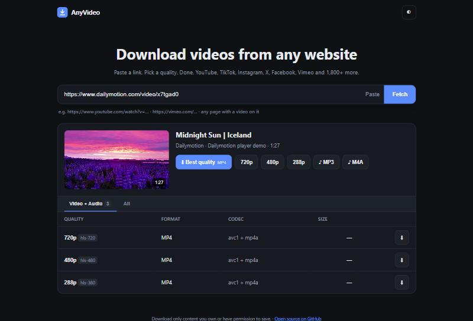

# AnyVideo Downloader

[](https://github.com/aethernode42/anyvideo-downloader/actions/workflows/ci.yml)
[](LICENSE)

A free, open-source video downloader. Paste a link, pick a quality, and get an MP4, MP3 or M4A. It works with YouTube, TikTok, Instagram, Facebook, X, Vimeo, Dailymotion, Twitch, SoundCloud and [1,800+ other sites](https://github.com/yt-dlp/yt-dlp/blob/master/supportedsites.md), plus most pages that have a plain HTML5 video.

It runs on your own computer, so it's free for everyone: no ads, no sign-up, no limits, and your links never pass through someone else's server.

**Website: https://aethernode42.github.io/anyvideo-downloader/**



## Ways to use it

| You want | Use |
|---|---|
| A simple page in your browser | [Web app](#web-app) |
| To type commands or script downloads | [Command line](#command-line) |
| A button on every video page | [Browser extension](#browser-extension) |
| To ask Claude to download things | [Claude Code plugin](#claude-code-plugin) |
| To run it on a home server or NAS | [Docker](#docker) |

Most options need two free tools: [uv](https://docs.astral.sh/uv/getting-started/installation/) (installs AnyVideo and its Python dependencies) and [ffmpeg](https://ffmpeg.org/download.html) (merges HD video with audio and converts to MP3). For YouTube, also install [Deno](https://deno.com/) or [Node.js](https://nodejs.org/) 20+. Docker needs none of these.

### Web app

```
uvx --from git+https://github.com/aethernode42/anyvideo-downloader anyvideo
```

This opens http://127.0.0.1:8765 in your browser. Paste a link and choose **Best quality**, a resolution, **MP3** or **M4A**, or any format from the table. Press Ctrl+C in the terminal to stop it.

### Command line

Install the `anyvideo` command once:

```
uv tool install git+https://github.com/aethernode42/anyvideo-downloader
```

Then:

```
anyvideo "https://www.youtube.com/watch?v=..."          # best quality MP4 into the current folder
anyvideo get "<link>" -q 720                            # best at or below 720p
anyvideo get "<link>" -a mp3                            # audio only (or -a m4a)
anyvideo get "<link>" -o ~/Videos                       # choose the folder
anyvideo info "<link>"                                  # list qualities and format ids
anyvideo get "<link>" -f 137                            # one exact format from 'info'
anyvideo                                                # open the web app
```

Update to the newest version (and newest yt-dlp) with `uv tool upgrade anyvideo-downloader`.

### Browser extension

Works in Chrome, Edge, Brave and Firefox (128+). It adds a toolbar button (**Download best quality**, **MP3**, **Choose quality**) and a **Download with AnyVideo** item to the right-click menu on pages, links and videos. It sends the page to the AnyVideo web app running on your computer, so start the [web app](#web-app) first. The popup shows whether it's running.

1. Download `anyvideo-extension-*.zip` from the [latest release](https://github.com/aethernode42/anyvideo-downloader/releases/latest) and unzip it. Or use the [`extension`](extension) folder from a clone of this repo.
2. **Chrome, Edge or Brave:** open `chrome://extensions`, turn on **Developer mode**, click **Load unpacked** and choose the unzipped folder.
3. **Firefox:** open `about:debugging#/runtime/this-firefox`, click **Load Temporary Add-on** and choose `manifest.json`. Firefox removes temporary add-ons when it restarts; a permanent install needs the add-on to be signed by Mozilla, which is free.

To use an AnyVideo server instead of your own computer, open **Settings** in the popup and enter its address.

### Claude Code plugin

In [Claude Code](https://claude.com/claude-code):

```
/plugin install anyvideo-downloader --marketplace aethernode42/anyvideo-downloader
```

On older versions of Claude Code, use two steps:

```
/plugin marketplace add aethernode42/anyvideo-downloader
/plugin install anyvideo-downloader@anyvideo
```

Then just ask, for example: *"download https://youtu.be/... as MP3 into my Music folder"* or *"what qualities does this video have?"*. Claude runs AnyVideo on your computer and tells you where the file was saved.

### Docker

The image includes ffmpeg and Deno:

```
docker run -p 8000:8000 ghcr.io/aethernode42/anyvideo-downloader
```

Open http://127.0.0.1:8000.

### From source

```
git clone https://github.com/aethernode42/anyvideo-downloader.git
cd anyvideo-downloader
uv run anyvideo
```

On Windows you can also double-click `run.bat`; on macOS and Linux, run `./run.sh`.

## Features

- One-click **Best quality**, a button for each resolution, and **MP3 / M4A** audio extraction
- A full format table (video + audio, video only, audio only) with file sizes and codecs
- Separate video and audio streams merged into an MP4 that plays everywhere (H.264/AAC preferred)
- Live progress bar, with the file saved automatically when it's ready
- Playlists show a list of videos to pick from
- Shareable links: `/?url=<video link>` opens straight to that video
- Dark and light themes, works on phones
- Hardened for public hosting: all download traffic goes through a built-in proxy that refuses private network addresses (even after redirects), plus rate limits, a file-size cap, a download time limit, and caps on simultaneous lookups and downloads

## Hosting your own online copy

Running AnyVideo on your own computer is free and works best. If you want a public website anyway, any host that runs a Dockerfile works. Two notes first:

- **Cost:** free tiers are small and usually sleep when idle. Video downloading uses a lot of bandwidth, so a busy public instance will outgrow a free tier.
- **YouTube** often blocks cloud servers with "Sign in to confirm you're not a bot". Most other sites work fine from a server.

**[Railway](https://railway.com)** (uses [`railway.json`](railway.json)): install the [Railway CLI](https://docs.railway.com/guides/cli), then:

```
railway login
railway init
railway up
railway variables --set CLIENT_IP_HEADER=x-real-ip
railway domain
```

`CLIENT_IP_HEADER=x-real-ip` makes the rate limit count each visitor separately, because Railway's edge replaces that header with the real visitor IP. On other hosts, check how they pass the visitor IP before setting it. Serverless hosts such as Vercel are a poor fit, because downloads run for a long time and produce large files.

## Settings

All settings are optional environment variables:

| Variable | Default | What it does |
|---|---|---|
| `PORT` | `8765` | Port to listen on. When set, the app listens on all interfaces. |
| `HOST` | `127.0.0.1` | Interface to listen on. |
| `MAX_CONCURRENT_JOBS` | `3` | Downloads that can run at the same time. |
| `MAX_CONCURRENT_INFO` | `4` | Link lookups that can run at the same time. |
| `MAX_FILESIZE_MB` | `2048` | Largest file allowed per download, enforced while downloading. `0` means no limit. |
| `JOB_TIMEOUT_SECONDS` | `1800` | A download that runs longer than this is stopped. |
| `RATE_LIMIT_PER_MIN` | `30` | Web app requests allowed per visitor per minute. `0` turns it off. |
| `CLIENT_IP_HEADER` | unset | Header holding the real visitor IP when you run behind a proxy that sets it. Leave it unset otherwise, because visitors could fake it. |
| `JOB_TTL_SECONDS` | `3600` | How long the web app keeps finished files before deleting them. |
| `DOWNLOAD_DIR` | your temp folder | Where the web app keeps files while your browser saves them. |
| `COOKIES_FILE` | `cookies.txt` | A Netscape-format cookies file for sites that need a login. |
| `COOKIES_BROWSER` | unset | Use your browser's cookies instead (for example `firefox`). |
| `ALLOW_PRIVATE_URLS` | unset | Set to `1` to allow links to local network addresses and turn off the built-in proxy. Only for private use, never on a public server. |

### Sites that need a login

Reddit, private Instagram posts and age-restricted YouTube videos need cookies from a logged-in browser. Either export a Netscape-format `cookies.txt` (a "Get cookies.txt" browser extension can do this) and set `COOKIES_FILE` to it (or put it in the folder you start AnyVideo from), or set `COOKIES_BROWSER=firefox`. Only do this on your own computer, never on a public server.

## How it works

The backend is a small [FastAPI](https://fastapi.tiangolo.com/) app ([`anyvideo/app.py`](anyvideo/app.py)) built on [yt-dlp](https://github.com/yt-dlp/yt-dlp). The frontend is a single HTML file ([`anyvideo/static/index.html`](anyvideo/static/index.html)) with no build step. The command line ([`anyvideo/cli.py`](anyvideo/cli.py)), the [browser extension](extension) and the [Claude Code skill](skills/download-video/SKILL.md) all use the same core.

| Endpoint | Purpose |
|---|---|
| `POST /api/info` `{url}` | Title, thumbnail, duration and every available format |
| `POST /api/jobs` `{url, mode, height?, format_id?}` | Starts a download. `mode` is `best`, `height`, `format`, `mp3` or `m4a`. |
| `GET /api/jobs/{id}` | Progress of a download |
| `GET /api/jobs/{id}/file` | The finished file |
| `GET /healthz` | Health check, including the yt-dlp version |

## Troubleshooting

- **"Could not reach this website"**: your network or internet provider may block that site, or the address is wrong.
- **A site that used to work stopped working**: sites change often. Get the newest yt-dlp with `uv tool upgrade anyvideo-downloader`, or run `uvx` with `--refresh`.
- **Live streams**: they never end, so they can't be downloaded. Recordings of past streams work.
- **"DRM-protected"**: streaming services such as Netflix and Disney+, and some Vimeo videos, use DRM. They can't be downloaded, by design.
- **The extension says AnyVideo isn't running**: start the [web app](#web-app) and keep its terminal open.

## Contributing

Contributions are welcome. See [CONTRIBUTING.md](CONTRIBUTING.md) to get set up, and run `uv run pytest` before opening a pull request.

## Responsible use

Only download videos you own, that are in the public domain, or that you have permission to save. Respect the terms of service of the sites you use and the rights of creators.

## License

[MIT](LICENSE)
